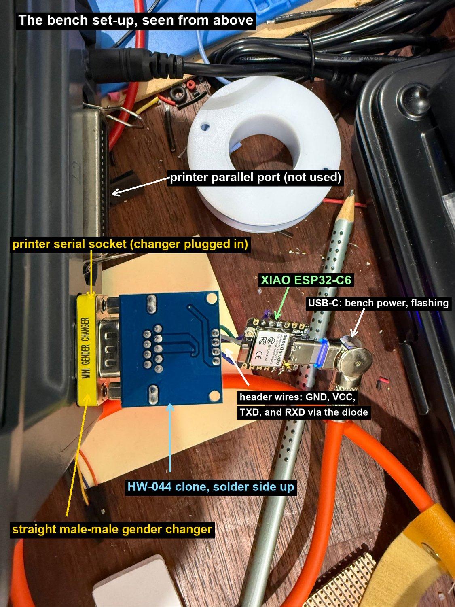
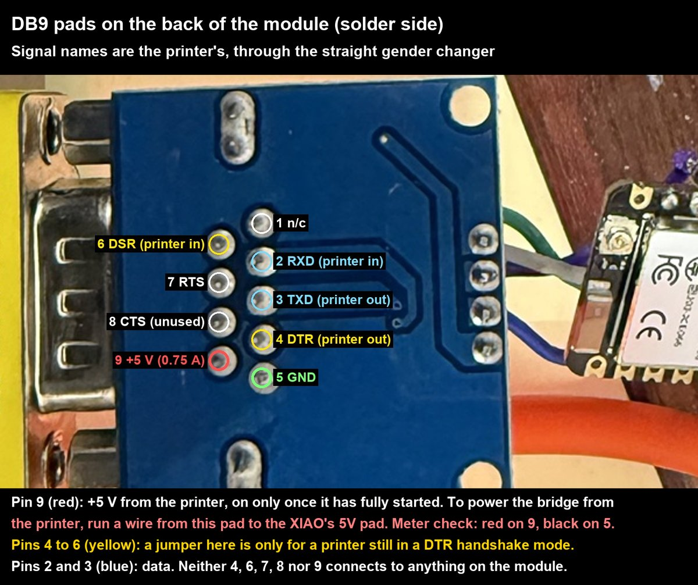
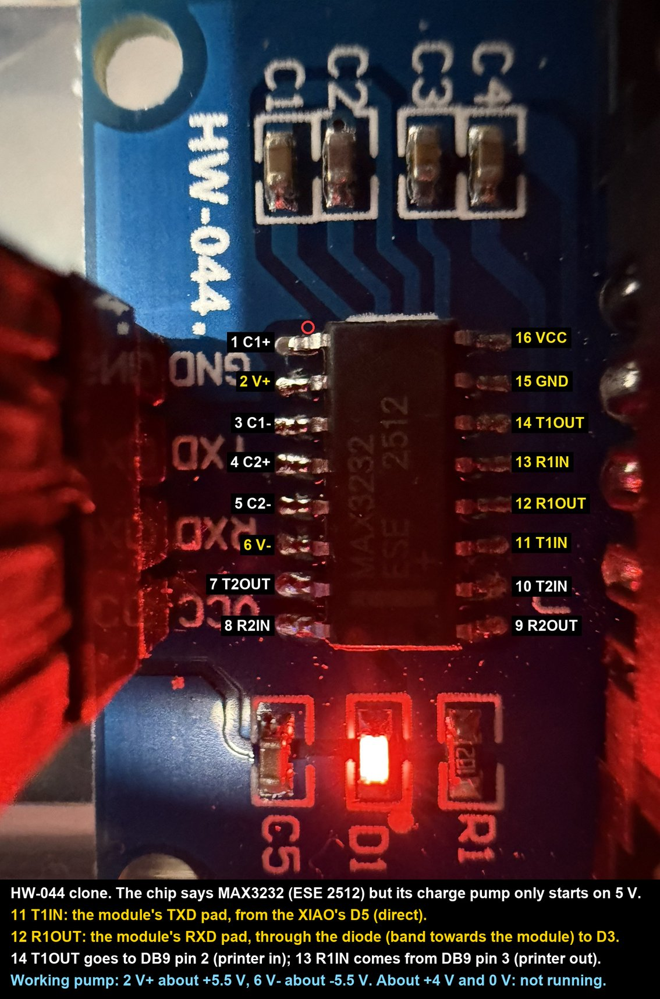
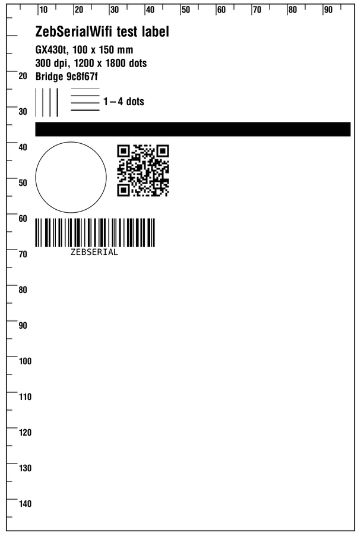

# ZebSerialWifi

A Wi-Fi to RS-232 bridge for Zebra label printers that have a serial port but no network connection. It plugs into
the printer's DB9 and shows up on the network as an ordinary network printer: raw TCP on port 9100, advertised over
Bonjour, with a web page for status and settings.

It is a Seeed XIAO ESP32-C6 and a MAX3232 RS-232 module in a small 3D-printed case. The firmware is ESP-IDF 6.1.

One unit is built and in use with a Zebra GX430t. Building one takes a few soldered wires and a diode, an ESP-IDF
toolchain for the first flash, and a 3D printer for the case.

## What it does

- **Printing:** raw TCP on port 9100, so the printer is added on a Mac as an IP printer ("HP Jetdirect – Socket") or
  picked from the Bonjour list. On port 9100, status replies (`~HS`, SGD) go back to the client.
- **Bonjour:** the bridge advertises itself as "Zebra *model* (*hostname*)", for example "Zebra GX430t (zebserial)",
  or "ZebSerial (*hostname*)" until it knows the model, and macOS picks its built-in "Zebra ZPL Label Printer" driver.
- **Serial link set-up:** it finds the printer by trying each baud rate, moves it to the target speed (115200 baud
  by default, set on the Bridge page; it steps down if the printer does not answer at that speed) with XON/XOFF flow
  control, and saves that in the printer.
- **Printer status:** it asks the printer for its status (`~HS`) every 30 s while no job is printing. A printer
  with an Energy Star or sleep timeout switched on (SGD `power.energy_star.enable` or `power.sleep.enable`, for
  example on the ZD421) would never get to sleep that way, so it is asked only while the Status page is open or
  something reads `/api/status`, at most every 30 s, and once after each job. If it stops answering it is asked
  every 10 s, so a printer switched off or replaced is still noticed. The GX430t has neither setting and is polled.
- **Web pages:** Status (printer state, configuration, the bridge's own state), Printer (the printer's settings and
  actions such as feed and calibrate) and Bridge (Wi-Fi, network, serial link, remote log and firmware updates).
- **Wi-Fi:** first set-up through its own access point; later changes from the Bridge page. A new network is tried for
  30 s and the bridge goes back to the old one if it fails.
- **Remote log:** sends its log to an [iot_log](https://github.com/Bwooce/esp-iot-log) receiver (on by default; it
  can be turned off on the Bridge page).
- **Chip temperature:** shown on the Status page, read every 30 s. At 85 °C it logs a warning (about 56 °C is
  normal in the case); the warning clears below 80 °C.

## Printers

| Printer | State |
|---|---|
| Zebra GX430t, firmware V56.17.16Z | Tested: printing, status, settings, baud change |
| Other Zebra ZPL printers with a DB9 RS-232 port (for example the G-series GK420 and GX420) | Not tested. Expected to work: same serial pinout and ZPL commands |
| Printers in EPL, CPCL or line-print mode | Jobs pass through, but the bridge sends no ZPL, so there are no status details or settings |

The printer needs a DB9 serial port wired as Zebra's G-series is: the printer is the DTE, receives on pin 2 and
transmits on pin 3. See [Printer serial settings](#printer-serial-settings) for the one setting that may need changing
first.

## Parts

| Part | Notes |
|---|---|
| Seeed XIAO ESP32-C6 | Any XIAO ESP32-C6. The ceramic antenna is used unless the firmware is built for U.FL. |
| MAX3232 RS-232 to TTL module (HW-044 or a clone of it) | The one used here is an HW-044 clone with a female DB9: "TTL-RS232" on the back, a 4-pin header (GND, RXD, TXD, VCC), parts labelled D1, R1, CP and C1 to C4, and a 16-pin chip. Sellers list it as "MAX3232 RS232 to TTL serial port converter module". The version with a **male** DB9 is better, since it plugs straight into the printer, but it is harder to find; the female version needs the gender changer below. The case in `enclosure/` is designed for the female version. See [Clone chips](#clone-chips-and-33-v). |
| Schottky diode | For the receive line when the module runs on 5 V. A BAT54 is best; a 1N5817 or 1N5819 works but wants the extra pull-up below. |
| DB9 gender changer, male to male, straight through | Only for a female-DB9 module: the module and the printer both have female sockets. Use a good one that connects all nine pins straight through, including pin 9 if the printer powers the bridge; cheap ones sometimes leave pins out or make poor contact. |
| Optional: 10 kΩ resistor, D3 to 3V3 | Needed with a 1N5817/1N5819 diode at 115200 baud; also makes the automatic pin detection reliable. |
| Optional: 10 kΩ resistor, D5 to 3V3 | Keeps the transmit line quiet while the XIAO resets. Without it, reset noise can leave the printer in a half-received label format. The firmware clears that, so this is optional. |
| Case | `enclosure/` (OpenSCAD) and `print/` (sliced for a Bambu Lab H2D, PETG) |

## Wiring



```
  XIAO ESP32-C6                  MAX3232 module                       gender           Zebra printer
                                 (header)          (its DB9)          changer          (DB9 socket)

  D5  (GPIO23) ────────────────▶ TXD  (chip pin 11, T1IN)
                                       T1OUT ───▶ pin 2 ─────────────── 2 ───────────▶ pin 2  RXD (printer in)

  D3  (GPIO21) ◀──┤◀──────────── RXD  (chip pin 12, R1OUT)
               anode  cathode         R1IN  ◀─── pin 3 ◀────────────── 3 ◀─────────── pin 3  TXD (printer out)
                     (band end
                      at module)

  GND ────────────────────────── GND ─────────── pin 5 ─────────────── 5 ──────────── pin 5  ground

  5V  ────────────────────────── VCC
   ▲
   └──────────────────────────────────────────── pin 9 ─────────────── 9 ◀─────────── pin 9  +5 V, 0.75 A
     (only if the printer powers the bridge;
      a wire to the pin 9 pad on the back of the module's DB9)
```

| From | To | Notes |
|---|---|---|
| XIAO D5 (GPIO23) | module TXD | Direct. This is the XIAO's transmit. |
| module RXD | diode cathode (band) | |
| diode anode | XIAO D3 (GPIO21) | The XIAO's receive. Never connect RXD straight to the XIAO while the module runs on 5 V. |
| XIAO GND | module GND | |
| XIAO 5V pad | module VCC | |
| DB9 pin 9 (back of the module) | XIAO 5V pad | Only to power the bridge from the printer. |

- **The module's TXD and RXD labels name the microcontroller pin to connect,** not what the module does: TXD is the
  module's input (the XIAO transmits into it) and RXD is its output.
- **The module transmits on its DB9 pin 2 and receives on pin 3,** the reverse of the printer. So a straight-through
  gender changer is right; a null-modem adapter would cross them back and nothing would work.
- **The firmware finds the pins itself** (Bridge page, Pins: "Detect at boot"). If it cannot tell, it uses TX on D5 and
  RX on D3, then tries them swapped if no printer answers. The pins can also be fixed on the Bridge page.
- **Pins 4, 6, 7 and 8 are not used.** See [Printer serial settings](#printer-serial-settings) for the DTR to DSR
  jumper, which is only for a printer still in a DTR handshake mode.

### Power

The module always takes its VCC from the XIAO's 5V pad. The 5V pad is fed either by the XIAO's USB-C or by the printer.

**From the printer:** DB9 pin 9 carries +5 V, fused, 0.75 A at most for the whole port (GX420t/GX430t User Guide,
Appendix A). There is no setting for it, and the bridge takes well under that. Pin 9 is not connected to anything on
the module, so it needs one extra wire from the pin 9 pad on the back of the module's DB9:

```
  Zebra printer        gender      MAX3232 module                         XIAO ESP32-C6
  (DB9 socket)         changer     (DB9 pads, back of the board)

  pin 9  +5 V ──────────── 9 ────── pin 9 pad ─────── extra wire ───────▶ 5V pad ──┐
                                                                                     │
                                   header VCC ◀──────────────────────────────────────┘

  pin 5  ground ────────── 5 ────── pin 5 (module GND) ── header GND ───── GND pad
```



- **The printer only turns pin 9 on once it has fully started.** After the printer is switched on, the bridge stays
  dark through the printer's own start-up and then boots, so it always starts with a printer that is ready. While the
  printer is off, the bridge is off too, and its web page is unreachable.
- **From USB instead:** the XIAO's USB-C, with no pin 9 wire. Useful on the bench and for flashing.
- With both, the printer's 5 V and the USB 5 V meet on the XIAO's 5V pad. Unplug the bridge from the printer before
  connecting USB.

## The diode, 3.3 V and clone chips

### Why the diode

The MAX3232's output to the microcontroller (R1OUT, the module's RXD) swings between 0 V and the module's supply. On
5 V that is too much for the ESP32-C6, whose pins are not 5 V tolerant. The Schottky diode lets the module pull the
XIAO's D3 low but never drive it high; the firmware turns on the RX pin's internal pull-up (D3 in this wiring),
which brings it up to 3.3 V.

- The internal pull-up is weak (about 45 kΩ), so the diode's capacitance sets how fast the line rises. A BAT54 (about
  10 pF) rises in 1 to 2 µs, well inside the 8.7 µs bit at 115200 baud. A 1N5817 or 1N5819 (about 110 pF) takes about
  7 µs, which is marginal; add 10 kΩ from D3 to 3V3 with one of those.
- The diode's band (cathode) goes to the module. The other way round, D3 sits high and nothing is received.

### Clone chips and 3.3 V

A genuine MAX3232 or SP3232 runs from 3.0 to 5.5 V. On 3.3 V its output to the microcontroller is already at a safe
level, so it can be wired straight to the XIAO's 3V3 pad with no diode: module VCC to 3V3, RXD directly to D3, and
TXD to D5 as before.

The chips on cheap modules are often clones that do not behave like that. In this project:

- **The first module** (a YL-97, male DB9) never ran its charge pump: its RS-232 output sat near 0 V, at 3.3 V and at 5 V.
- **The second module**, the one in the case, is marked "MAX3232" but its charge pump does not start at 3.3 V. At 5 V
  it gives about −8 V and +9 V and works. So it runs on 5 V with the diode.



To check a module before wiring it in: power it from 3.3 V with nothing on the DB9, and measure DB9 pins 2 and 3
against pin 5. A working module's transmit pin (pin 2 on this layout) idles at about −5 to −6 V. If both read near 0 V,
the charge pump is not running at that voltage: try 5 V with the diode, or another module. MAX3232 pin 2 (V+) should
be about +5.5 V and pin 6 (V−) about −5.5 V.

## Other XIAO boards

The firmware is written for the XIAO ESP32-C6. Another Wi-Fi XIAO (ESP32-C3 or ESP32-S3) should work, but needs a
small port that has not been done:

- **Build target:** `idf.py set-target esp32c3` (or `esp32s3`).
- **Pin numbers:** the firmware uses GPIO numbers, not XIAO pad names. D3 and D5 are GPIO21 and GPIO23 on the C6, but
  different GPIOs on the other boards (`board.c`, `Kconfig.projbuild`).
- **Antenna, LED and BOOT button:** `board.c` drives the C6's RF switch (GPIO3 and GPIO14), its LED (GPIO15) and BOOT
  (GPIO9). Those lines would need changing or removing. The C3 and S3 use a plug-in antenna, which must be fitted.
- **Case:** `enclosure/` is built around the C6's outline, USB-C and shield.

The XIAO nRF52840, RP2040 and SAMD21 have no Wi-Fi, so they cannot be used.

## Printer serial settings

The bridge uses XON/XOFF flow control only. The printer's serial handshake must be "XON/XOFF".

**What happened with the GX430t here:** its configuration label said "DTR & XON/XOFF", a combined G-series mode. In it
the printer received commands and printed, but sent nothing back, so the bridge could not find it. Two changes went in
together and it answered: a jumper from DB9 pin 4 (the printer's DTR output) to pin 6 (its DSR input), and an XON
character. Its handshake was then set to XON/XOFF only and saved. The jumper has since been removed and everything
still works, which matches the user guide: with XON/XOFF selected, "the DTR control lead will have no effect."

So the DTR jumper was a set-up barrier from the printer's handshake setting, not a firmware fault. But the firmware
does not fully remove the barrier on its own: it sets the handshake with `^SC`, and this printer ignored the handshake
part of `^SC`. The change that worked was Zebra's SGD command.

For a printer whose configuration label (hold FEED until the light flashes once) shows a DTR handshake:

1. **Set the handshake once.** With the bridge on the network, send:

   ```
   printf '! U1 setvar "comm.handshake" "xon/xoff"\r\n^XA^JUS^XZ' | nc zebserial.local 9100
   ```

   then turn the printer off and on. (On the GX430t here the setvar was sent, saved and the printer reset; this exact
   one-line form has not been run as written.) The printer accepts commands in the DTR mode even though it does not reply, so
   this gets through. A Zebra utility over USB can set it too.
2. **Or fit the jumper** from pin 4 to pin 6 on the back of the module's DB9 (neither pin is connected to anything on
   the module). That lets a printer in a DTR mode reply, so the bridge works with the printer left as it is. Step 1
   still makes the jumper unnecessary.

Check the new configuration label, or the Status page's Serial link line, shows XON/XOFF.

Also:

- **The printer does not answer status requests while it has a fault** (paper or ribbon out, head open). A printer in
  thermal transfer mode with no ribbon fitted is in a ribbon-out fault, and looks dead to the bridge. Use direct
  thermal for direct-thermal labels.
- **Language:** a printer set to EPL, CPCL or line print gets no ZPL from the bridge. "EPL_ZPL" (automatic) is fine.

## Firmware

ESP-IDF 6.1, target `esp32c6`, in `firmware/`. The iot_log component comes from GitHub through the component manager.

```
cd firmware
. ~/esp/esp-idf-v6.1/export.sh
idf.py build
idf.py -p /dev/cu.usbmodemXXXX flash monitor
```

On macOS, put Homebrew's Python first in `PATH` if `export.sh` says Python 3.10 or newer is missing.

Host unit tests for the parsers (no ESP-IDF needed): `make -C firmware/test_host`.

### Updates over the network (OTA)

The flash has two firmware slots. After the first flash over USB, new firmware goes over the network:

- **Bridge page, Firmware:** choose `firmware/build/zebserial.bin` and press Upload and restart.
- **Or from a terminal:** `curl --data-binary @firmware/build/zebserial.bin http://zebserial.local/update`

The bridge checks the upload is a ZebSerialWifi image for the ESP32-C6 and that it arrived whole, writes it to the
other slot and restarts into it. The new firmware is kept if it is on Wi-Fi once it has been running 15 s. If it is
not on Wi-Fi within 180 s, or crashes before then, the bridge goes back to the previous firmware. The Bridge page
can also restart into the other slot by hand ("Go back to ...").

Anyone on the network can upload firmware, as they can already change the settings. Uploads from another web site are
refused.

The first flash with this two-slot layout must be over USB (`idf.py flash`), since the partition table and the
bootloader that does the rollback are not updated over the network. The settings survive it.

## Setting up

1. **Join Wi-Fi.** On first start the bridge opens an open network called `ZebSerial-XXXX`. Join it; the set-up page
   opens (or go to http://192.168.4.1/). Choose the network and enter its password.
2. **Find it:** http://zebserial.local/ (the hostname can be changed on the Bridge page).
3. **Add the printer on a Mac:** System Settings, Printers & Scanners, Add Printer. Pick "Zebra GX430t (zebserial)"
   (your model) from the list; Use should say "Zebra ZPL Label Printer". If the Mac does not see it (some networks
   lose multicast between access points), add it by IP instead: the IP tab, protocol "HP Jetdirect – Socket", address
   `zebserial.local` or the bridge's IP address.
4. **Set the queue to the printer's resolution.** The Zebra ZPL driver defaults to 203 dpi, so on a 300 dpi printer
   every label comes out at two-thirds size. macOS has no setting for it in Printers & Scanners, so use Terminal
   (`lpstat -p` lists the queue names):

   ```
   lpadmin -p Zebra_GX430t__zebserial_ -o Resolution=300dpi
   lpoptions -p Zebra_GX430t__zebserial_ -l | grep Resolution
   ```

   The second line should show `*300dpi`. A 203 dpi printer needs nothing.
5. **Check the printer:** the Status page shows the model, language, serial speed and handshake, and any fault. The
   Printer page's **Print test label** prints a border 1 mm in from the edges, mm rulers, line widths, a solid band
   (white streaks are dead printhead dots), a 20 mm circle (an oval means a dpi mismatch) and two barcodes, at the
   label size you give it. Nothing is saved in the printer.

   

Holding the XIAO's BOOT button for 5 s clears the Wi-Fi and network settings and restarts it in set-up mode.

The test label also has 0 to 4 mm scales at the two top corners, measured in from each side edge. Where the label's
edge falls on each shows how far the print is off centre; the Printer page says how to turn the two readings into a
Left Position change.

## Printing from a web page

Like Zebra's own network printers, the bridge prints whatever ZPL is posted to `/pstprnt`:

```
curl --data-binary @label.zpl http://zebserial.local/pstprnt
```

It answers to pages from any site (`Access-Control-Allow-Origin: *`), so a label page saved on a computer can print
and read the reply. Anyone on the network can already print through port 9100; what is new is that a web page you
visit can print too, and ZPL can change the printer's settings. Only open label pages you trust. It is refused on the
set-up network. It also answers a browser's CORS preflight (OPTIONS, including Chrome's private network check), so
a page may send JSON or its own headers. The reply says how many bytes went to the printer; the printer's own
replies are not passed back. 503 means the printer was busy for 15 s (another job, or the bridge reading its status
or settings), and 504 means the printer stopped taking data for 30 s (paper or ribbon out, head open) and the rest
of the job was dropped.

`tools/cable-labels.html` is such a page: flag labels for cables on 60 x 20 mm stock, the same text on both ends with a
blank middle that wraps round the cable. Open it in a browser and type one cable per row. On a Mac the browser must be
allowed Local Network access (macOS asks the first time; otherwise System Settings, Privacy & Security, Local Network),
or every print fails with "Couldn't reach".

## Remote log

The Bridge page's Remote log section sends a copy of the log to an [iot_log](https://github.com/Bwooce/esp-iot-log)
receiver. It is on by default, but nothing is sent until mDNS finds a receiver on the network; there is no address to
set. The Status page shows whether a receiver was found.

"Found" only means mDNS answered. Access points with multicast-to-unicast conversion (or IGMP snooping) forward the
log group only to clients whose membership report they have seen. A receiver that joined long ago, or roamed to
another access point since, can be left out, while mDNS (link-local multicast, never filtered) keeps working. The
iot_log receiver re-joins the group every 60 s, which keeps it listed.

## Case

`enclosure/` has the OpenSCAD model and its README (fit, sections and checks); `print/` has the sliced Bambu Lab H2D
project and its settings. The unit plugs straight into the printer's serial socket through the gender changer.

## Troubleshooting

| Symptom | Likely cause |
|---|---|
| Printer not found at any baud | The handshake (see above), a printer fault, the diode the wrong way round, or a module whose charge pump is not running |
| Printer prints but never answers | A DTR handshake mode, or a fault such as ribbon out |
| No Language row on the Status page for a while after boot | Reset noise left the printer mid-format; the bridge clears it and reads the language again within about 10 minutes. The D5 pull-up stops it at the source. |
| Printer page: "No complete reply to ^HH" | The printer has stopped running formats (seen once with the head not fully latched). Close the head properly and turn the printer off and on. |
| Remote log: receiver found, but no lines arrive | The access point no longer forwards the group to the receiver: update the iot_log receiver (it re-joins every 60 s) |
| No 5 V on pin 9 at the module | The gender changer does not carry pin 9, or a bad connection; measure at the printer's own socket |

## Licence

MIT: see [LICENSE](LICENSE). It covers the firmware, the case files and the label page.
